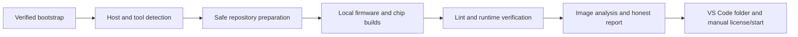
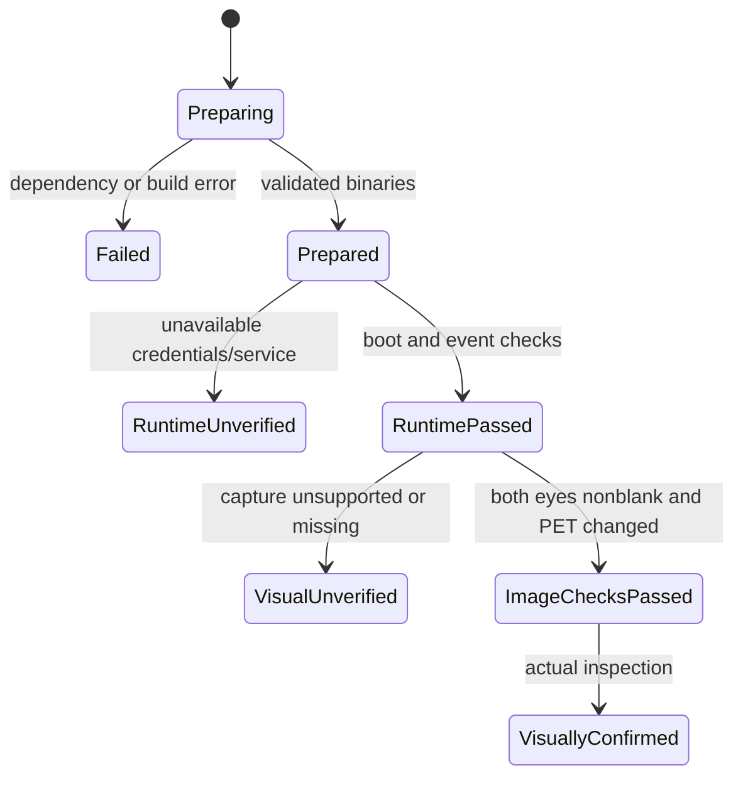

# Windows simulator installer

## Goal Capsule

**Objective:** A new Windows developer can prepare Tando from one PowerShell command, open the simulator in VS Code, and know which build, runtime, and visual checks actually passed.

**Means:** A central PowerShell installer with terminal prompts, user-scoped dependencies, local builds, and conservative verification (KTD1–KTD4).

**Authority:** The supplied mission defines the outcome; repository `AGENTS.md` defines repository and release rules; this plan defines implementation. Work stays on `feature/wokwi-dual-gc9a01` and updates existing draft PR #20 against `develop`. No merge, tag, release, or production-firmware change is authorized.

**Execution profile:** Native implementation with independent research and review. The calling workflow owns commits, push, PR editing, and CI observation. A missing Wokwi credential prevents runtime proof, not implementation or publication of an honestly documented draft.

**Stop conditions:** Preserve local changes on every Git conflict. Stop the affected installation stage when a download, build, required output, or verification fails. Report unavailable external access as unverified. Never turn boot output into a claim of correct eye rendering.

---

## Product Contract

### Summary

Provide one Windows entry point that prepares dependencies, obtains the simulator, builds and validates its outputs, runs Wokwi checks when authorized credentials are available, and opens the simulator folder in VS Code. Explain the remaining license and Start Simulator actions in English and Persian.

### Problem Frame

The simulator already has a circuit, firmware adapter, custom chip model, PlatformIO configuration, and build CI. A new contributor must currently install tools and assemble the environment manually. Existing successful builds have not established that both eyes render correctly in Wokwi.

### Requirements

R1. Support Windows 10/11 PowerShell from any directory with only VS Code preinstalled; detect a missing VS Code installation and stop with recovery guidance.

R2. Reuse compatible Git, Python, PlatformIO, Wokwi CLI, and official Wokwi extension installations; prepare missing dependencies in user scope without hidden elevation.

R3. Provide an inspectable, immutable download-and-run command with integrity validation and no `Invoke-Expression` or global execution-policy change.

R4. Default the repository to `$env:USERPROFILE\Documents\Tando-Wokwi\tendo`, accept another path in the terminal, retain existing local modifications, validate repository/branch identity, and permit only safe updates.

R5. Ask for a missing `WOKWI_CLI_TOKEN` using hidden input, reuse an existing environment token only through actual service verification, never persist or print it, and distinguish CLI access from extension licensing.

R6. Build `firmware.bin`, `firmware.elf`, and `gc9a01.chip.wasm` from the checked-out source in their configured paths; reject absent or invalid outputs.

R7. Validate structure, two-display wiring, Wokwi lint, ESP32 boot banners, serial events, and absence of panic/crash; diagnose the reported SPI warning within simulator scope.

R8. Attempt left/right Idle and PET screenshots using officially supported scenario syntax; reject blank, black, missing, stale, or unchanged evidence and reserve final rendering correctness for actual visual review.

R9. Open `simulator/wokwi` through the VS Code CLI, explain official license activation and Start Simulator, and preserve existing Serial commands and production behavior.

R10. Make reruns safe and report firmware version, commit, working-tree state, tools, failed stage, recovery, logs, screenshots, and next action without false success.

R11. Preserve English simulator documentation, append a comprehensive Persian guide, synchronize `README.fa.md`, and add the requested Persian root README section with portable links.

R12. Add isolated automated tests for scenarios A–J without uninstalling host tools, update CI, and publish reviewed changes to PR #20 while retaining its visual-verification caveat.

### Scope Boundaries

In scope: installer, helpers only where needed, simulator transport/model corrections supported by evidence, automated tests, CI, and documentation. Physical MPR121/RC522 remain replaced by existing Serial event adapters.

Out of scope: product personality, Stage/Progress/Care semantics, root firmware, release metadata, tags, releases, VS Code installation, purchase/OAuth automation, GUI input automation, and destructive Git repair. Intermediate feature work needs no release bump under `AGENTS.md` section 27.

### Sources

- The user-supplied “Tando One-Command Windows Simulator Installer” mission, including scenarios A–J.
- `AGENTS.md`, `README.md`, `VERSION`, `CHANGELOG.md`, and `.github/workflows/release.yml`.
- Existing `simulator/wokwi` sources, tests, build configuration, README files, and `.github/workflows/wokwi-simulator.yml`.
- Current baseline: `develop` commit `f181cc2285b06f70d2cce2113d30d698a2c98ac8`, firmware `0.10.0-rc.8`; it is the simulator branch merge base and the root firmware is unchanged.
- Official Wokwi documentation and upstream CLI releases must govern supported runtime commands. The research stage verified Wokwi `v0.29.1` Windows x64 and MinGit `v2.56.0.windows.3` download digests through the live GitHub API.

---

## Planning Contract

### Key Technical Decisions

KTD1. Keep one PowerShell entry point and make side effects explicit. Functions may be loaded without running installation so isolated tests can drive detection, Git safety, token cleanup, and failure reporting. Preserve Windows PowerShell 5.1 compatibility.

KTD2. Publish the bootstrap after the installer code commit exists: the later documentation commit points to that immutable commit and records the script SHA-256. This avoids a self-referential commit hash and branch-content substitution. Validate downloaded executable integrity against pinned upstream digests or official signatures before execution.

KTD3. Prefer user-owned portable Git and an isolated PlatformIO Python environment. Resolve supported official Python installation behavior and compatible versions before authoring its bootstrap. Do not assume winget, Python, Git, or package managers exist initially. Tool paths must also work in the VS Code terminal after installation.

KTD4. Build locally and bind evidence to the current source. Do not add an artifact fallback unless local compilation proves infeasible; any fallback must prove source-commit and integrity equivalence. Clear or isolate generated runtime evidence before each run, without deleting user sources.

KTD5. Separate “prepared”, “runtime passed”, “automated image checks passed”, and “visually confirmed”. Failed cloud authorization or unsupported screenshot capture leaves visual status unverified. A valid token is used only in the child process environment and restored/removed in cleanup.

KTD6. Preserve `.github/workflows/release.yml`. Extend simulator CI with Windows PowerShell installer tests, structural/image-verifier unit tests, and existing firmware/WASM checks. A conditional cloud smoke job must be explicitly skipped when its secret is unavailable, never replaced by a success claim.

### High-Level Technical Design

### Assumptions

- The first reproducible Windows toolchain targets x64; other architectures require verified compatible upstream binaries before claiming support.
- CLI subscription/access and extension licensing are external account states. They may require a paid plan or manual browser action according to current official documentation.
- No Wokwi token is currently available to this execution environment. Tests can verify correct rejection and reporting with mocks; those mocks cannot establish real rendering.
- Detecting nonblack pixels and Idle/PET differences is a necessary smoke test, not proof of anatomical or animation correctness.

### Deferred Implementation Questions

The exact Python distribution/version, test harness shape, screenshot backend support, SPI-warning cause, and image thresholds are resolved during implementation from official sources and observed results. None permits silently weakening R1–R12.

---

## Implementation Units

### U1. Install dependencies and obtain the repository safely

**Goal:** One terminal entry prepares the reusable development environment.

**Requirements:** R1–R5, R10; KTD1–KTD3.

**Dependencies:** None.

**Files:** `simulator/wokwi/install.ps1`; dependency metadata/helper if needed; `simulator/wokwi/tests/test_install.ps1`; `simulator/wokwi/.gitignore`.

**Approach:** Detect the supported host and VS Code first. Detect working tools by executing their version probes. Install verified missing tools in user scope. Request the path and token only after startup. Validate existing Git roots/remotes/branch and use safe fast-forward updates; preserve dirt and give recovery guidance.

**Execution note:** Establish isolated characterization/failure tests before running any real installer mutation. Tests must not alter host tools, user profile configuration, or credentials.

**Patterns to follow:** Existing `[env:tando-s3-sim]`, simulator-only isolation, Conventional Commit history, and feature-branch release exemption.

**Test scenarios:**

1. A/I: no tools except VS Code chooses verified user-scoped installs and needs no administrator.
2. B/J: compatible tools and an existing checkout are reused; a second run performs no unnecessary reinstall.
3. C: dirty or conflicting Git content is byte-for-byte preserved; wrong repository/branch is rejected before update.
4. D/E: missing token uses hidden input; invalid token has a redacted actionable failure and cleanup restores the environment.
5. Missing VS Code, unsupported host, failed download/integrity, and failed dependency commands stop at their real stage.

**Verification:** Automated tests exercise these state transitions, PowerShell parses under 5.1 and current PowerShell, and every actual installation is reported separately from mocked results.

### U2. Build outputs and verify runtime and both displays

**Goal:** The installer reports validated firmware/model output and genuine runtime evidence.

**Requirements:** R6–R10; KTD4–KTD5.

**Dependencies:** U1.

**Files:** `simulator/wokwi/install.ps1`; `simulator/wokwi/tests/smoke.yaml`; `simulator/wokwi/tests/test_project.py`; `simulator/wokwi/tests/test_visual.py`; image verification helper; narrowly evidenced changes to `sketch.ino` or `gc9a01.chip.c` when necessary.

**Approach:** Build through pinned PlatformIO and official Wokwi CLI. Check output signatures/size and current-source freshness. Run structural tests and lint, then scenario execution with isolated serial and screenshot outputs. Analyze both eyes and PET differences, scan serial for boot/event/crash evidence, and provide explicit partial status when cloud/image support is unavailable. Investigate the MISO warning against the pinned Arduino SPI implementation before making a simulator-only fix.

**Patterns to follow:** `tests/test_project.py`, `tests/smoke.yaml`, `wokwi.toml`, and existing Serial handlers.

**Test scenarios:**

1. F: absent outputs trigger local builds; a build failure or invalid binary prevents runtime.
2. A valid two-eye circuit passes; removed display or wrong shared/control pin fails structural validation.
3. Boot banners without images, panic after boot, missing serial output, or SPI failure cannot report full success.
4. G: missing, stale, uniform black, transparent, malformed, or unchanged PET screenshots fail the automated image check.
5. Distinct nonblank Idle/PET fixtures on both sides pass the image smoke check while preserving the need for actual review.
6. H: VS Code receives the simulator folder through CLI; license status remains unverified unless observed through a supported mechanism.

**Verification:** Structural and verifier tests pass. Actual firmware/WASM builds and lint are attempted. A live Wokwi run and visual inspection are claimed only if credentials, supported capture, and actual image inspection all occurred.

### U3. Document the entry point and enforce it in CI

**Goal:** A second contributor can repeat the same workflow and understand its real limitations.

**Requirements:** R3, R9, R11–R12; KTD2, KTD6.

**Dependencies:** U1–U2.

**Files:** `README.md`; `simulator/wokwi/README.md`; `simulator/wokwi/README.fa.md`; `simulator/wokwi/BUILD.md`; `simulator/wokwi/COLLABORATION.md`; `.github/workflows/wokwi-simulator.yml`; documentation/bootstrap consistency tests where useful.

**Approach:** Retain English instructions and append the full Persian workflow. Make the independent Persian file a clear maintained pointer or synchronized guide. Include the same immutable validated bootstrap, safe token entry, official license activation, live simulation controls, screenshots, rebuild/update/team workflow, and troubleshooting. Add Windows 5.1/current-PowerShell test coverage and honest optional runtime CI.

**Test scenarios:**

1. All documented installation commands select the same immutable installer content and expected hash.
2. A command copied outside the repository can bootstrap without Git/Python/winget.
3. Missing cloud secret gives an explicit skipped runtime job; static/build jobs remain meaningful.
4. Persian and English instructions agree on paths, license distinction, commands, and actual verification status.

**Verification:** Relative links resolve; bootstrap hash matches the published installer commit; Windows tests and firmware/WASM CI complete on the final PR head; PR #20 records remaining visual evidence accurately.

---

## Verification Contract

Run the existing structural test and new behavioral tests without deleting host software. Use temporary repositories/tool stubs for destructive/error scenarios and real image fixtures for the verifier. Run meaningful Windows PowerShell 5.1 and PowerShell tests, firmware compilation, Wokwi chip compilation, and lint. Check `git diff --check` and confirm root firmware, VERSION, CHANGELOG, release workflow, tags, and release branches remain unchanged.

Record actual command, result, and evidence path for each check. Record mocked scenarios separately from clean-machine installation. If a real token is unavailable, report cloud runtime, four screenshots, simultaneous rendering, FOOD/SLEEP/Blink GUI behavior, and extension activation as unverified. Preserve the Draft PR state until actual visual evidence exists.

---

## Definition of Done

The requested installer, secure copyable bootstrap, automated checks, full bilingual guide, root README section, and CI changes are reviewed and pushed to the existing simulator branch and PR #20. Every claim in the report reflects an observed result, with remaining manual license/start steps and runtime limitations named. Complete graphical acceptance additionally requires actual inspection of both running eyes and their reactions; build success alone cannot satisfy it.
